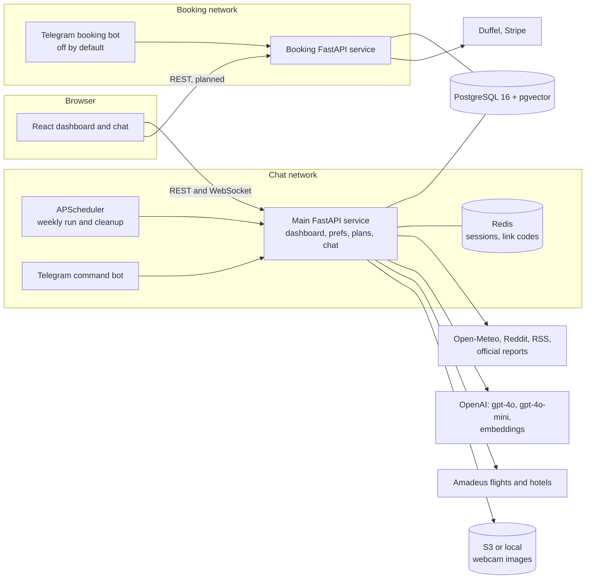
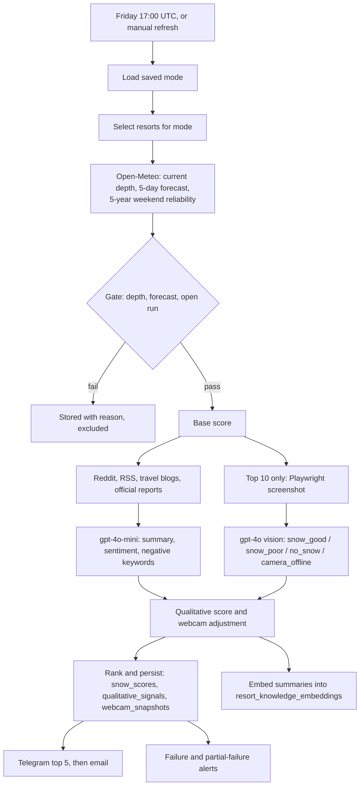
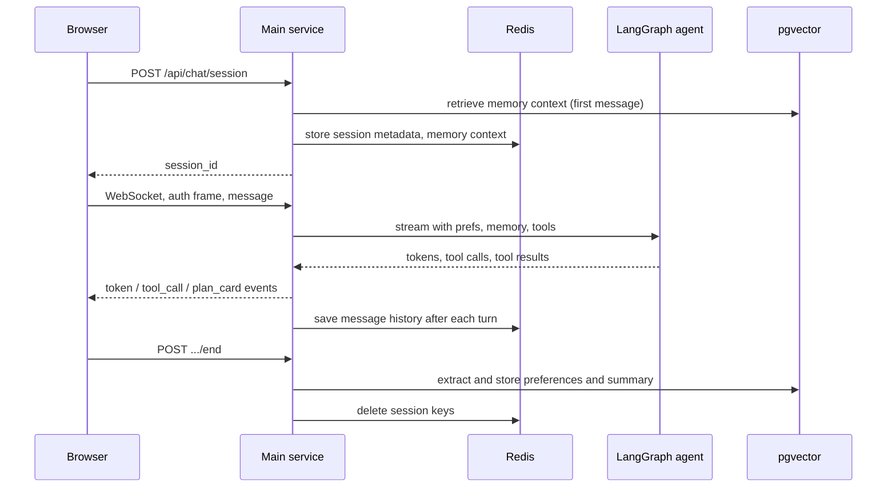
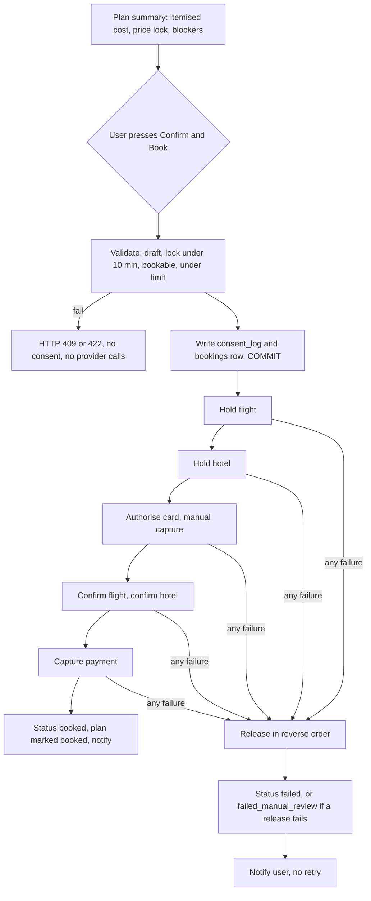

# Snow Intelligence Agent — Project Overview

**Date:** 20 November 2026
**Scope:** the `snow-agent` application (backend, booking service, React frontend) as implemented in this repository.
**Companion documents:** [snow-agent-spec.md](snow-agent-spec.md) (product spec), [implementation-plan.md](implementation-plan.md) (phase plan and status table).

---

## 1. App idea

### 1.1 Problem

European snow destinations have become unreliable. A London-based traveller who wants a winter weekend trip (November–March) has repeatedly arrived at resorts with too little snow. Checking weather services, resort sites, Reddit and booking sites by hand is slow and inconsistent.

### 1.2 Solution

An automated weekly service that:

1. Scores snow conditions at 70 European destinations (40 ski resorts, 30 snow-tourism destinations).
2. Excludes any destination that fails a hard snow gate, so a cheap flight can never tempt the user towards a bad trip.
3. Sends the top 5 every Friday to Telegram and email, and shows the top 10 on a web dashboard.
4. Lets the user explore the results through a chat agent that remembers their preferences.
5. Ends the chat with a concrete **draft trip plan** (flight and hotel with real prices).
6. Optionally books that plan through a separate, firewalled service behind an explicit consent step.

### 1.3 Users and modes

A single primary user (the app is single-tenant today), based in London by default, who can change their home city.

| | Winter sports | Snow tourism |
|---|---|---|
| Destinations | Ski resorts with lifts (40) | Villages, towns, scenic areas (30) |
| Minimum snow depth | 40 cm | 15 cm |
| Weather exclusion | Rain, or max temperature above 3 °C, in the 5-day forecast | Same |
| Qualitative sources | r/skiing, r/snowboarding, r/Alps, snow reports | Travel subreddits, travel-blog RSS |

Mode is stored in the user's preferences and is resolved first in every path: weekly run, dashboard, chat tools.

### 1.4 Governing principles

These are enforced in code, not just documented.

| # | Principle | How it is enforced |
|---|---|---|
| P1 | Booking firewall | Separate service, container, image, env file and network. Startup guards refuse to run if secrets cross over. No chat or dashboard module imports the booking package (tested). |
| P2 | Explicit consent | `consent_log` row is committed before the first provider call. `user_confirmed` must be the JSON boolean `true`. Table is append-only via database triggers. |
| P3 | Mode first | Mode comes from saved preferences before any fetch, score or query. |
| P4 | Score before search | Flight, hotel and plan tools only work for a resort that passed the gate in the latest completed run. |
| P5 | Fail loud | Partial failures appear in the run's `error_log`, dashboard banners, Telegram and email. Rollbacks never retry silently. |
| P6 | Cached weekly data | Dashboard and chat read PostgreSQL. Live calls happen only on request and are capped at 10 per chat session. |

### 1.5 Out of scope

Non-European destinations, long-haul or multi-week trips, car hire or ski passes, group bookings, and travellers other than the single configured user.

---

## 2. Architecture

### 2.1 System overview

`db` is the only container on both networks. The chat container has no network route to the booking container.

### 2.2 Services

| Service | Entry point | Responsibility |
|---|---|---|
| Main service | `app.main:app` (port 8000) | Preferences, dashboard, plans, chat sessions, weekly scheduler, Telegram commands, readiness |
| Booking service | `app.booking.main:app` (port 8001) | Plan summary, consent, booking sequence, status, history, Telegram booking |
| Frontend | `frontend/` (Vite, port 5173 in dev) | Dashboard, preferences, chat, plan cards |
| PostgreSQL | `pgvector/pgvector:pg16` | All structured data and vector tables |
| Redis | `redis:7-alpine` | Chat session state, live-call counters, Telegram link codes |

### 2.3 Code layout (`snow-agent/app`)

| Package | Purpose |
|---|---|
| `clients/` | Open-Meteo, Reddit (praw), RSS (feedparser), official reports (BeautifulSoup), OpenAI wrapper, Amadeus hotel search |
| `scoring/` | Gate and score engine, qualitative scorer |
| `runner/` | `WeeklyRunOrchestrator` |
| `scheduler/` | Friday 17:00 UTC run, daily snapshot cleanup |
| `webcam/` | Playwright capture, vision classifier, retention, evaluation harness |
| `storage.py` | Local or S3 webcam storage |
| `delivery/` | Telegram and SendGrid senders, weekly report dispatch, Telegram command bot |
| `chat/` | LangGraph agent, tools, session lifecycle, Redis store, memory (RAG) |
| `plans/` | Plan serialisation, delivery, routes |
| `prefs/` | City registry, preference service, routes, Telegram link codes |
| `dashboard/` | Cache-only queries and routes |
| `booking/` | Separate service: config, models, providers, engine, API, notifications, Telegram booking |
| `db/` | SQLAlchemy models and sessions |
| `isolation.py`, `readiness.py`, `logging_config.py` | Secret-boundary checks, `/ready`, JSON logs |

### 2.4 Weekly run

Design points:

- **Parallel and bounded:** semaphores limit Open-Meteo, qualitative and webcam concurrency; an 8-minute budget caps the qualitative stage.
- **Degrade visibly:** a failing source yields a neutral value and an entry in `error_log`, never a silent substitute.
- **Duration tracked:** a run over 30 minutes logs a warning.

### 2.5 Snow score (0–100)

| Component | Range | Basis |
|---|---|---|
| Depth | 0–30 | Mode-specific brackets |
| Forecast stability | 0–30 | No rain, no warm days, bonus for new snowfall |
| Historical reliability | 0–25 | Share of recent weekends above the depth threshold |
| Qualitative | 0–20 | Sentiment and negative keywords, adjusted by webcam: +3 good, −2 poor, −5 none, 0 offline |

The total is capped at 100.

### 2.6 Chat session

### 2.7 Booking sequence

Booking states: `consented`, `flight_held`, `hotel_held`, `payment_authorised`, `booked`, `failed`, `failed_manual_review`. Every transition is stored in `booking_events`. A partial unique index allows only one non-failed attempt per plan.

### 2.8 Data model

| Table | Purpose |
|---|---|
| `resorts` | 70 destinations: coordinates, altitude, mode, airports, webcam URL |
| `weekly_runs` | One row per run: status, counts, `error_log` |
| `snow_scores` | Per-resort gate result, score components, rank |
| `qualitative_signals` | Source type (reddit, rss, official), summary, sentiment, keywords |
| `webcam_snapshots` | Classification, description, stored image reference |
| `user_prefs` | City, airports, mode, budget, excluded airlines, email, Telegram chat |
| `trip_plans` | Draft plans: owner, flight, hotel, totals, delivery errors, status |
| `preference_embeddings`, `trip_feedback_embeddings`, `resort_knowledge_embeddings`, `session_summary_embeddings` | pgvector memory (1536 dimensions, cosine) |
| `consent_log` | Append-only legal record of each consent |
| `bookings`, `booking_events` | Booking state machine and history |

Migrations: `0001`–`0006` (Alembic).

### 2.9 Security and isolation

- **Auth:** bearer token on every route; the booking service has its own token and middleware. WebSocket authenticates with a first frame because browsers cannot set headers.
- **Secret boundary:** the chat service refuses to start with `DUFFEL_API_KEY`, `STRIPE_SECRET_KEY`, `HOTEL_BOOKING_API_KEY` or `BOOKING_API_TOKEN`. The booking service refuses `OPENAI_API_KEY`, `AMADEUS_*` or `REDDIT_*`.
- **Network:** `chat_net` and `booking_net` are disjoint; `db` is on both.
- **Data handling:** no card data touches the app (Stripe tokens only). Chat messages live in Redis for at most 24 hours. Memory extraction strips obvious email, phone and card patterns before storing.
- **Spend guard:** bookings above `MAX_BOOKING_TOTAL_GBP` (default £5000) are refused.
- **Path safety:** webcam images are only served from the configured snapshot directory or the configured S3 bucket.

---

## 3. Tech stack

### 3.1 Backend

| Area | Technology |
|---|---|
| Language | Python 3.11+ (3.12 in local venv) |
| Web | FastAPI 0.116, Uvicorn, WebSockets |
| Validation and config | Pydantic v2, pydantic-settings |
| Database | PostgreSQL 16, SQLAlchemy 2 (async), asyncpg, Alembic |
| Vectors | pgvector (`vector(1536)`, ivfflat, cosine) |
| Cache and sessions | Redis 7 (`redis` 8.1) |
| Scheduling | APScheduler 3.11 |
| Agent framework | LangGraph 0.4, langchain-core, langchain-openai |
| LLM and embeddings | OpenAI: `gpt-4o` (chat, vision), `gpt-4o-mini` (summaries, memory extraction), `text-embedding-3-small` |
| HTTP | httpx |
| Scraping and feeds | praw (Reddit), feedparser, BeautifulSoup4, Playwright (Chromium) |
| Travel data | Amadeus SDK (flights, hotels); Duffel REST (booking) |
| Payments | Stripe REST, PaymentIntents with manual capture |
| Delivery | python-telegram-bot, SendGrid, Jinja2 |
| Object storage | boto3 (S3), local filesystem by default |

### 3.2 Frontend

React 18, TypeScript, Vite, Tailwind CSS 3, TanStack React Query 5 (server state), Zustand 5 (local state, token), Vitest + Testing Library, Playwright.

### 3.3 Infrastructure

Docker and Docker Compose (separate images for main and booking services), Redis and Postgres containers with health checks, migrations on start, JSON logging, `/health` and `/ready` on both services.

### 3.4 Testing

| Layer | Tooling | Count |
|---|---|---|
| Backend | pytest, pytest-asyncio, pytest-httpx, hypothesis, fakeredis, aiosqlite | 286 |
| Frontend unit | Vitest | 11 |
| Frontend browser | Playwright (mocked API and WebSocket) | 6 |

Backend DB tests run on in-memory SQLite through a small harness that swaps PostgreSQL-only types; PostgreSQL itself is not exercised.

---

## 4. Detailed feature list

Legend: **Done** = implemented and tested; **Mocked** = implemented but verified only against test doubles; **Config** = code complete, needs your data or credentials.

### 4.1 Snow intelligence

| Feature | State |
|---|---|
| 70 seeded resorts (40 sports, 30 tourism), idempotent seed script | Done |
| Open-Meteo current depth and temperature, 5-day forecast, 5-year reliability, retries and rate limiting | Done |
| Mode-specific hard gate with recorded exclusion reasons | Done (open-run check not enforced, see §6) |
| Four-part score and ranking | Done |
| Friday scheduler and manual refresh, duplicate-run protection | Done |
| Run duration tracking and failure logging | Done |

### 4.2 Evidence

| Feature | State |
|---|---|
| Reddit posts (mode-specific subreddits) | Mocked |
| SnowForecast RSS | Mocked |
| Travel-blog RSS for tourism mode | Mocked; Config (`TOURISM_RSS_FEEDS`) |
| Official resort report scraping | Mocked; Config (`data/report_sources.json`, empty) |
| LLM summary, sentiment, negative keywords | Mocked |
| Webcam screenshot (Playwright) and vision classification, top 10 only | Mocked; Config (0 of 70 webcam URLs) |
| S3 or local image storage, 90-day cleanup | Mocked |
| Vision accuracy check against labelled images | Done (harness); Config (no labelled set) |

### 4.3 Preferences

- Home city with airport list (London plus Manchester, Birmingham, Edinburgh, Glasgow, Bristol); London default.
- Departure airports, excluded airlines, mode, budget, email, Telegram chat.
- Validation against the city registry; one user's data is never visible to another.

### 4.4 Dashboard and web UI

- Ranked top-10 cards with score breakdown, depth, temperature, reliability, qualitative summary and flagged keywords.
- Webcam thumbnail through an authenticated fetch; offline, loading and failed states.
- Mode toggle, city and airport selection, budget input.
- Last-updated badge; banners for failed runs, in-progress runs, partial failures and results older than a week.
- Empty, loading and error states; responsive layout with a mobile chat toggle.
- Manual "Refresh data" for admins.
- Latest draft plan with cancel.

### 4.5 Chat and planning

- Streaming conversational agent with seven read-only tools (see §5).
- Tool-activity events and a draft plan card pushed over the WebSocket.
- Itemised plan: flight, hotel, total, dates, with a clear "no booking has been made" statement.
- Plan delivery to Telegram and email; delivery failures are stored and shown.
- One plan per session; plans require a gate-passing resort.

### 4.6 Delivery and Telegram

- Weekly top-5 report (Telegram first, then HTML email), failure and partial-failure alerts.
- Telegram commands: `/start <code>` (one-time link code), `/mode`, `/budget`, `/report`, `/plan`, `/help`.

### 4.7 Booking

| Feature | State |
|---|---|
| Separate service with own auth, env, image and network | Done |
| Plan summary with itemised cost, price-lock countdown, blockers | Done |
| 10-minute price lock | Done |
| Consent before any provider call; append-only log | Done (trigger tested as migration text only) |
| Hold → hold → authorise → confirm → capture, with reverse-order rollback | Done (fake providers) |
| `failed_manual_review` when a rollback step fails | Done |
| Confirmation and failure notifications (email and Telegram) | Done |
| Duffel hold-order provider | Mocked |
| Stripe authorise-and-capture provider | Mocked |
| Hotel booking provider | Not built (refuses loudly) |
| Telegram `/book` and `/confirm` (off by default, unlocks after 4 web bookings) | Done (fake engine) |

### 4.8 Operations

JSON logs with structured fields, `/ready` with per-dependency status, migrate-on-start, container health checks, startup secret checks.

---

## 5. Agentic AI and RAG

### 5.1 Where AI is used

| Use | Model | Agentic? |
|---|---|---|
| Chat assistant with tools | gpt-4o via LangGraph | **Yes**: the model decides which tools to call and loops |
| Qualitative summarisation per resort | gpt-4o-mini, JSON output | No: fixed pipeline step |
| Webcam classification | gpt-4o vision, JSON output | No: fixed pipeline step |
| Session memory extraction | gpt-4o-mini, JSON output | No: runs once at session end |
| Embeddings | text-embedding-3-small | No |

The weekly run is a deterministic orchestrated pipeline. Only the chat assistant is an agent.

### 5.2 The chat agent

**Graph:** a LangGraph `StateGraph` with an `agent` node (streams the model) and a `tools` node (`ToolNode`), connected by `tools_condition`. The agent calls tools until it has an answer.

**System prompt** carries: current mode, home city and airports, budget, retrieved memory, and rules (use the cache first, label live data, never invent conditions or prices, never imply a booking).

**Tools** (exactly seven; registry drift raises an error at build time):

| Tool | Purpose | Guardrails |
|---|---|---|
| `filter_results` | Filter the latest weekly cache by depth, altitude, country, score | Read-only; mode from preferences |
| `fetch_live_snow` | Live Open-Meteo depth, temperature, forecast | Max 10 per session (Redis counter) |
| `fetch_webcam` | Latest cached classification, or a fresh capture | Falls back to cache |
| `search_flights_readonly` | Amadeus offers, GBP only, sorted by price | Gate-passing resort only; origin must belong to home city; excluded airlines applied; cannot book |
| `search_hotels_readonly` | Amadeus hotel offers, GBP only | Gate-passing resort only; cannot book |
| `get_historical_reliability` | Five-year weekend reliability | Reads cache |
| `create_plan_artifact` | Save a draft plan and send it | Flight and hotel must match offers returned in this session; dates must match; both need explicit GBP prices; one per session; resort must still pass the gate |

**What the agent cannot do:** book, pay, query bookings, or call any `/booking/*` route. There is no booking tool, no booking credential in its environment, and no network path.

**State:** metadata, message history, live-call counter and last search results live in Redis (24 h TTL). LangGraph's in-process checkpointer is rebuilt from the saved history after a restart.

**Streaming protocol:** plain text tokens, plus typed events (`tool_call`, `plan_card`). Tool output is never streamed as chat text.

### 5.3 RAG and long-term memory

Retrieval-augmented generation here means retrieving stored text by vector similarity and placing it in the agent's system prompt.

**Stores (pgvector, 1536 dimensions, cosine distance):**

| Table | Content | Written by |
|---|---|---|
| `preference_embeddings` | Durable preference statements ("prefers quiet villages") | Session end |
| `session_summary_embeddings` | One summary per session | Session end |
| `resort_knowledge_embeddings` | Weekly qualitative summaries, tagged by season | Weekly run |
| `trip_feedback_embeddings` | Post-trip feedback | **Nothing yet** (read only) |

**Retrieval (first message of a session):** the message is embedded, then four bounded searches run in parallel:

| Search | Limit |
|---|---|
| Past preferences for the user | 3 |
| Trip feedback for the user | 2 |
| Resort knowledge for the current season | 3 |
| Recent session summaries (last 30 days) | 1 |

Results are formatted as a `[MEMORY CONTEXT]` block in the system prompt.

**Writing (session end):** gpt-4o-mini extracts preferences and one summary from the transcript. Obvious personal data is redacted, preferences are de-duplicated (similarity ≥ 0.95), and only the extracted text is stored. Raw messages are never persisted.

**Cost controls:** gpt-4o-mini for all high-volume steps; one summary call per resort per week; Amadeus is called only on user request; embedding writes are de-duplicated.

### 5.4 Honest limits of the AI layer

- Retrieval runs once per session, on the first message, not per turn.
- No re-ranking, no hybrid keyword search, no retrieval quality evaluation.
- The resort knowledge corpus is only the weekly summaries; no curated guides or historical reports.
- No automated evaluation of agent answers or tool choice beyond unit tests with a fake model.
- Memory quality depends on the extraction prompt, which has not been tuned on real conversations.

---

## 6. Development status and what is left

### 6.1 Status by phase

| Phase | State | Notes |
|---|---|---|
| 1 Preferences and residence city | Done | |
| 2 Redis sessions | Done | |
| 3 Dashboard API | Done | |
| 4 React dashboard | Done | No booking UI |
| 5 Plans, hotel search, delivery | Done | Hotel search not run against live Amadeus |
| 6 Evidence hardening | Code done | Needs your data (below) |
| 7 Booking service | Backend done | Cannot complete a real booking yet |
| 8 Telegram booking | Code done, disabled | Gated by design |
| 9 Production readiness | Repo level done | No cloud infrastructure |

### 6.2 What blocks a real booking

1. **No hotel booking provider.** The hotel provider refuses every attempt. The Booking.com affiliate API in the spec does not offer booking, so a provider decision is needed.
2. **Flight source mismatch.** Chat finds flights through Amadeus; Duffel can only book Duffel offers. Plans must carry a Duffel offer ID and passenger ID. Fix: search flights through Duffel in chat, or book through Amadeus.
3. **No payment screen.** The Stripe Payment Element, saved-card handling and the "Confirm & Book" button are not built. This needs a Stripe publishable key and a design choice (Stripe customer plus SetupIntent).
4. **No live verification** of Duffel, Stripe or Amadeus Hotels calls; tests use mock transports.

Until these are resolved every plan reports `bookable: false` with the reasons.

### 6.3 Needs your input

| Item | Where |
|---|---|
| Webcam URL for each of the 70 resorts (currently 0) | `data/webcams.json`, then re-run `python -m scripts.seed_resorts` |
| Official report pages per resort | `data/report_sources.json` |
| Labelled webcam images (aim for ≥ 85% agreement) | `scripts/eval_webcam.py` |
| Travel-blog RSS feeds for tourism mode | `TOURISM_RSS_FEEDS` |
| API keys: OpenAI, Reddit, SendGrid, Telegram, Amadeus; test-mode Duffel and Stripe | `.env`, `.env.booking` |

### 6.4 Known gaps in implemented features

| Gap | Impact |
|---|---|
| Sports mode "at least one blue or green run open" gate is not enforced; lift and run status data is not collected, so the check is skipped | A resort with deep snow but closed lifts can pass |
| `trip_feedback_embeddings` is never written | The "Trip feedback" retrieval always returns nothing |
| No feedback capture after a trip | Memory cannot learn from outcomes |
| Hotel search has no property-type filter; address is not available from the Amadeus response | Spec fields only partly met |
| WebSocket route is `POST /api/chat/session` plus `WS /api/chat/session/{id}/messages` rather than the single `WS /api/chat/session` in the spec | Documented deviation |
| Single-tenant: one bearer token maps to one user, who is also the admin | Not suitable for multiple users |
| `has_open_run`, SnowForecast and Reddit parsing are only tested with mocks | Real-world format drift is untested |
| The frontend has no booking, plan history or Telegram-link screens (the link-code API exists) | Users must call the API for the code |
| No CORS configuration; the frontend relies on the Vite dev proxy | A separate production origin needs a reverse proxy or CORS rules |
| No migration run against a real PostgreSQL instance | Migrations 0003–0006 are rendered as SQL only |

### 6.5 Not started

- AWS deployment: ECS Fargate, RDS, ElastiCache, S3 bucket, Secrets Manager, TLS reverse proxy, backups.
- Monitoring and alerting beyond logs (metrics, dashboards, alarms for a missed Friday run).
- Multi-user support and a real login flow.
- Automated evaluation of the agent and of retrieval quality.
- Four weekend runs compared to known conditions (the spec's manual validation).

### 6.6 Suggested order of work

1. Run the stack with real keys: `docker compose up`, seed resorts, trigger a refresh, confirm a full weekly run on PostgreSQL.
2. Curate webcam and report sources; run the vision check.
3. Decide the flight and hotel booking providers, then build the Payment Element and booking UI against sandbox accounts.
4. Add run and lift status data so the open-run gate can be enforced.
5. Add trip-feedback capture so the memory loop closes.
6. Provision cloud infrastructure and monitoring.
7. After four real web bookings, enable Telegram booking.
