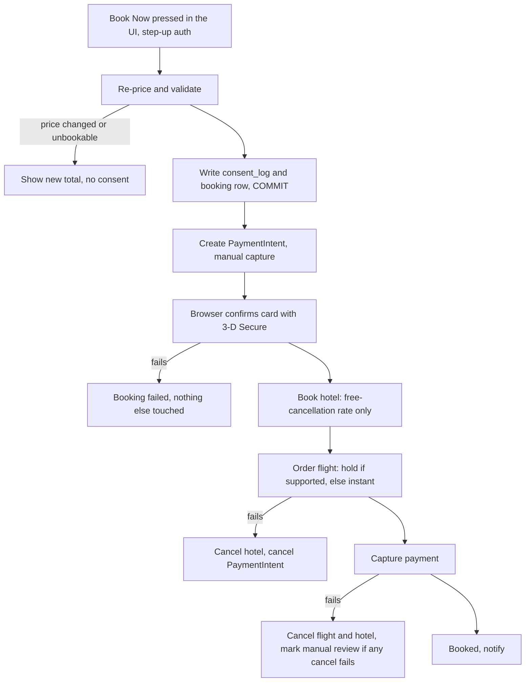

# Further Implementation Plan

**Date:** 20 November 2026
**Source:** [further-implementation.md](further-implementation.md) (the action plan), checked against the code in `snow-agent/` and against [PROJECT_OVERVIEW.md](PROJECT_OVERVIEW.md).
**Goal:** a system that is **fully functional** (validated Friday top 5, plans with real bookable prices, one real end-to-end booking, runs unattended) and **foolproof** (no silent failures, money moves only through the consent path, every failure mode has a test, a runbook entry or a kill switch).

How to read this document:

- **Section 1** says which findings in the source plan hold up against the code, and lists corrections and extra problems found while checking.
- **Section 2** lists the decisions that unblock work, each with a recommended default.
- **Sections 3–5** give the schedule, the milestones with task-level detail, and the cross-cutting changes (migrations, config, kill switches).
- **Owner tags:** **[A]** I can implement it in code. **[Y]** needs you (credentials, real observations, money, decisions). **[A+Y]** both.
- **Priority tags:** **P0** on the critical path to the first real booking, **P1** needed for go-live, **P2** worth doing, can slip.

---

## 1. Findings checked against the code

### 1.1 Findings in the source plan

| ID | Verdict | Evidence in the repo | Plan adjustment |
|---|---|---|---|
| F1 Amadeus shut down July 2026 | **Unverified here.** I cannot confirm it from the codebase. | Chat flight and hotel search are Amadeus-only (`app/chat/tools.py`, `app/clients/amadeus_hotels.py`). | Fixed in M3. First task: confirm against Amadeus's own announcement (T3.0). The rework is still needed even if it is wrong, because Amadeus offers cannot be booked through Duffel (see N7). |
| F2 Forecast is 0–30, components sum to 105 | **Confirmed.** | `app/scoring/engine.py` `score_forecast`: stable base 25, plus 5 for incoming snowfall, clamped at 30. Depth 30 + forecast 30 + history 25 + qualitative 20 = 105, then `min(100, …)`. Spec says forecast is 25 including the snowfall bonus. | M1 T1.1. |
| F3 Open-run gate not enforced | **Confirmed.** | `app/runner/weekly_run.py` passes `has_open_run=None`; `apply_gate` skips the check when it is `None`. No lift data is collected. | M1 T1.3, T1.4. |
| F4 Nothing run on real PostgreSQL | **Confirmed.** | Tests use SQLite through `tests/orm_sqlite.py`. Migrations 0003–0006 were only rendered offline. No CI exists (`.github/` is absent). | M0. |
| F5 Depth/temperature at the wrong elevation | **Confirmed.** | `app/clients/open_meteo.py` sends only `latitude`/`longitude` (no `elevation`), so values come from the model grid cell and its default terrain height. `resorts` stores `altitude_base_m` and `altitude_peak_m` but they are never used in a request. | M1 T1.2. Check in the Open-Meteo docs which variables the `elevation` parameter actually adjusts (temperature is downscaled; snow depth is likely not). |
| F6 Chat needs a search credential, firewall forbids Duffel keys | **Confirmed, and worse than stated.** See N7. | `app/isolation.py` lists `DUFFEL_API_KEY` as booking-only. | M3 T3.4. |
| F7 Duffel may not cover low-cost carriers | **Plausible, unverified.** | No Duffel search code exists yet. | M3 T3.1. Note the test-mode caveat in N8. |
| F8 No hotel provider, payment UI, booking UI | **Confirmed.** | `UnconfiguredHotelProvider` refuses every attempt; no Stripe Elements code in `frontend/`. | M3, M4. |
| F9 Sources only tested with mocks; 0 of 70 webcam URLs | **Confirmed.** | `data/webcams.json` and `data/report_sources.json` are `{}`. | M2. |
| F10 `trip_feedback_embeddings` never written | **Confirmed.** | Only `app/chat/memory.py` reads it. | M5 T5.1. |
| F11 Static bearer tokens, no login, no CORS | **Confirmed.** | `app/auth.py` compares one shared token; the frontend stores it in `localStorage` (Zustand persist); no CORS middleware exists in either service. | M4 T4.5, M6, M7. See D7 on how login interacts with the firewall. |
| F12 No deployment, monitoring or missed-run alarm | **Confirmed.** | Only logs and `/ready` exist. | M7. |

### 1.2 Corrections to the source plan

| # | Source says | Actual | Effect |
|---|---|---|---|
| C1 | T0.3: test the "booking state-machine trigger" | No such trigger exists. Only the `consent_log` append-only triggers and the partial unique index exist (migration 0006). | Either drop it from T0.3 or add the trigger. This plan adds it, but **after** the sequence redesign in T4.3, so it is not written twice (T4.3b). |
| C2 | T1.7: "weights recent winters more heavily, as the spec says" | The spec does not say that. It says "% of weekends in last 5 years that met threshold" with no recency weighting. The code does the unweighted version. | T1.7 becomes a design choice, not a verification. See N1. |
| C3 | T4.6: add idempotency keys | Partly there: Stripe `authorise` already sends `Idempotency-Key: booking-{id}`. Duffel calls and the confirm endpoint have none. | T4.6 narrows to Duffel, the confirm endpoint, and the other Stripe calls. |
| C4 | T3.4: use a separate Duffel organisation for search | **Unconfirmed.** Duffel's docs confirm that test and live tokens see separate resources, and that offers expire (`expires_at`, typically within 30 minutes) and should be re-fetched with `GET /air/offers/{id}` when ready to book. They do not say whether an offer made under one organisation's token can be booked under another's. | Do not rely on it. Store an itinerary fingerprint and re-price at booking time (T3.5, T3.7); that design works whether or not offers are organisation-scoped. Confirm with Duffel support during T3.1. See N7 and D3. |

### 1.3 Problems found that the source plan does not mention

| # | Problem | Evidence | Where handled |
|---|---|---|---|
| N1 | **Historical reliability counts every weekend of the year**, including summer. The 5-year window is `today − 5×365 days` and filters only on Saturday/Sunday, so most days have no snow anywhere and reliability is pulled towards zero for all resorts. The spec's intent is the November–March season. | `get_historical_reliability` in `open_meteo.py` | T1.7 (restrict to the season, then decide on recency weighting). |
| N2 | The `get_historical_reliability` chat tool takes no month, although the spec defines `month` and a year-by-year breakdown. | `app/chat/tools.py` | T1.7. |
| N3 | The scheduler runs inside the web process, and compose starts uvicorn with `--reload`. More than one worker, or any reload, would duplicate or drop the Friday job. | `docker-compose.yml`, `app/main.py` lifespan | T7.1. |
| N4 | The Telegram polling bot also runs inside the web process. Two processes polling one token causes `Conflict` errors. | `app/main.py` | T7.1. |
| N5 | `official_report.py` follows redirects with no host allowlist or private-address check; Playwright navigates to any `webcam_url`. | `app/clients/official_report.py`, `app/webcam/classifier.py` | T2.9. |
| N6 | Containers run as root, and Playwright's Chromium launches with its sandbox disabled by default. | `Dockerfile`, `classifier.py` | T7.9. |
| N7 | The chat flight tool returns Amadeus offers, and Duffel can only book Duffel offer IDs. The plan's `flight_option` has no Duffel offer ID, so nothing the chat produces can be booked today. | `DuffelFlightProvider.blockers` | M3. |
| N8 | Duffel's test mode is a sandbox, so a coverage matrix built with a test token does not show real inventory. Duffel's docs say test mode reaches airline sandboxes plus its own "Duffel Airways", whose schedules and prices are unrealistic. | Duffel test-mode documentation (checked 20 Nov) | T3.1 uses live-mode read access to judge real carrier coverage and prices (searching spends no money). Test mode is for the T4.12 rehearsal only. |
| N9 | All Phase 1–9 work is **uncommitted** (many modified and untracked files on the `base` branch). | `git status` | T0.0. |
| N10 | The sports gate compares today's depth with 40 cm in the first run of a season. In late November many resorts are legitimately below it, so the first validation weekends may have very few positive cases. | Season timing | M1 note on validation design. |

---

## 2. Decisions

| ID | Decision | Needed by | Recommendation and why |
|---|---|---|---|
| D1 | Flights: bookable in the app (Mode A) or assisted with deep links (Mode B) | end of T3.1 | Decide from live-mode coverage. Default to **Mode B for any route Duffel does not return**, per route, not globally. The plan card works in both. |
| D2 | Hotels: bookable provider or assisted | end of T3.3 | Default **assisted** unless a provider with free-cancellation rates and API booking is available for your destinations. |
| D3 | Chat search credential | before T3.5 | **Separate Duffel organisation with no payment method**, plus re-matching the itinerary at booking time. Choose the **search-only proxy** instead only if re-matching proves unreliable in the spike (it holds a full key, so it is a smaller service to protect but a bigger secret). |
| D4 | Hosting | before M7 | One VPS or Railway/Fly-style host running Docker Compose with automatic TLS. |
| D5 | Keep or drop Reddit | end of T2.1 | Drop it if credentials are not available within a day; the neutral fallback already exists. |
| D6 | Telegram booking stays off until four web bookings | decided | No change. |
| **D7 (new)** | How the booking service authenticates you | before T4.5 | A token or session signed by anything the chat service holds lets a compromised chat container mint booking access, which breaks P1. Use **separate booking-service credentials with step-up at "Book Now"** (password plus TOTP or a passkey), not a token shared with the chat side. |
| **D8 (new)** | Single origin | before M6 | Serve the frontend, `/api/*` and `/booking/*` behind one reverse proxy on one origin. This removes CORS and lets cookies be `HttpOnly; SameSite=Strict`. The proxy joins both networks but is not the chat container. |

---

## 3. Schedule

Today is Friday 20 November 2026. Weekends map to the source plan's W-numbers as follows.

| Week | Dates | Focus |
|---|---|---|
| W1 | 21–22 Nov | M0, plus the code in T1.1–T1.6 and T1.8 if time allows |
| W2 | 28–29 Nov | Finish M1 code and harness; M3 spike (T3.0–T3.3); start M2 |
| W3 | 5–6 Dec | **Validation clock starts** (first Friday run under a frozen `score_version`); M2 sources |
| W4 | 12–13 Dec | Validation weekend 2; M3 rework (T3.4–T3.8) |
| W5 | 19–20 Dec | Validation weekend 3; M4 start; M5 start |
| W6 | 26–27 Dec | Validation weekend 4 (earliest M1 exit); M4 |
| W7–W9 | 2–17 Jan | M4 completion, M5, M6 |
| W10–W12 | 23 Jan–7 Feb | M7 and the real-money pilot |

Constraints worth knowing:

- **Three streams overlap in W2–W5** (M1, M2, M3), all on one person's weekends. The validation stream is cheap (a short Monday entry), which is what makes the overlap workable. The M3 spike is the one item that needs a full day.
- **The validation clock only counts once the scoring code is frozen.** The source plan starts M1 in W2; that only works if T1.1–T1.6 and the harness T1.8 land in W1–W2. Otherwise the clock starts later and every later date moves.
- **Validation freeze rule:** tuning is allowed during the first two validation weekends. The last two must run on one unchanged `score_version`. Any scoring change after that starts a new version and resets the count.
- **Christmas and New Year** fall inside W5–W7; plan for fewer weekends of effective work.
- The "first real booking around January" holds only if M3 decisions land by W4.

Suggested weekly rhythm once validation is running: Friday 17:00 UTC run → Friday evening check the Telegram top 5 → weekend work → Monday 10 minutes recording `validate_week.py` entries.

---

## 4. Milestones

### M0 — Real infrastructure baseline

**Goal:** prove the system runs on real PostgreSQL and Redis with real clients, and make that repeatable.

| ID | Pri | Owner | Task | Detail | Done when |
|---|---|---|---|---|---|
| T0.0 | P0 | A+Y | Commit the existing work in logical commits | Phases 1–9 are uncommitted (N9). Split by area (preferences, Redis sessions, dashboard, frontend, plans, evidence, booking, ops). Do this before any new change so each new task is a clean diff. | Clean `git status`; branch pushed |
| T0.1 | P0 | Y | Create `.env` and `.env.booking`; `docker compose up` | Copy from `.env.example` and `.env.booking.example`. Chat env must not contain booking keys and the reverse; the startup guards will refuse otherwise. | `/ready` returns 200 on ports 8000 and 8001 |
| T0.2 | P0 | A | Fix migrations 0003–0006 on real PostgreSQL and add CI | Create `.github/workflows/ci.yml` with `pgvector/pgvector:pg16` and `redis:7` service containers. Run `alembic upgrade head`, then `alembic downgrade base`, then `upgrade head` again. Migration 0002's downgrade drops tables in a particular order; fix any failure the round trip exposes. | CI green for up, down, up |
| T0.3 | P0 | A | PostgreSQL-only tests | New `tests/pg/` directory, skipped unless `TEST_DATABASE_URL` is set; CI sets it. Cover: `consent_log` `UPDATE`, `DELETE` and `TRUNCATE` each raise; the partial unique index allows a second booking only after a `failed` one; foreign keys from `bookings.plan_id` to `trip_plans`; pgvector cosine queries (`<=>`) return nearest-first and the ivfflat index creates; JSONB round trips. The state-machine trigger test is added with T4.3b. | Tests pass in CI |
| T0.4 | P0 | A | `scripts/smoke_live.py` | One call per real client: Open-Meteo (forecast and archive), OpenAI chat and embedding, Telegram message, SendGrid email. Flags `--only` and `--skip`; prints PASS/FAIL with the error; exits non-zero on any failure. Uses the smallest possible model calls. | One-line status per client |
| T0.5 | P0 | A+Y | First real run | `python -m scripts.seed_resorts`, trigger `POST /api/dashboard/refresh`, then read `weekly_runs.error_log` entry by entry. Fix what is genuinely broken; record what is just a missing key. | One `complete` run on PostgreSQL; Telegram top 5 received |

**Exit gate:** a real run, real delivery, CI green.

---

### M1 — Score correctness and validation

**Goal:** the score reflects reality, and you can prove it before any money-moving work is trusted.

| ID | Pri | Owner | Task | Detail | Done when |
|---|---|---|---|---|---|
| T1.1 | P0 | A | Forecast maximum 25 | In `score_forecast`: stable and dry = 20, incoming snowfall adds up to 5, ceiling 25. Keep the rain and warm penalties. Remove reliance on the `min(100, …)` cap in `compute_score` (keep it only as a defensive assert in tests). | Hypothesis property: best inputs give exactly 100; no input gives an uncapped sum above 100 |
| T1.2 | P0 | A | Per-resort elevation | New `resorts` columns `mid_altitude_m` and `village_altitude_m` (seed from `altitude_base_m` and `altitude_peak_m`; mid = base + 0.5·(peak − base) as a start, refine by hand for a few resorts). Sports use mid, tourism use village. Pass `elevation` to Open-Meteo for forecast and archive calls if the docs confirm it affects the variable; otherwise apply a documented lapse-rate correction to temperature only. Store `elevation_used_m` on each `snow_scores` row. | Test resorts show sensible differences between base and mid values |
| T1.3 | P0 | A | Tri-state open-run gate | `open_run_status` ∈ `open`, `closed`, `unknown` on `snow_scores`. `closed` excludes with reason `no_open_run`. `unknown` passes, is flagged in the dashboard and Telegram brief, and loses a configured number of points (start at 5). Where a data source exists (official report adapters in T2.4, or a lifts feed), populate it; otherwise it stays `unknown` and is visible. Replace the current "`None` means skip" behaviour. | No resort passes without a recorded status |
| T1.4 | P0 | A | Season window | `season_open` and `season_close` on `resorts` (month/day). Outside the window the resort is excluded with a stated reason, as a cheap proxy for lifts not yet running. Seed defaults per region, then correct by hand. | Out-of-season resorts excluded with reason |
| T1.5 | P1 | A | Temperature rule | Use elevation-adjusted forecast temperature (T1.2). Make the 3 °C threshold and the rain threshold configurable per mode. Log near misses (within 1 °C or 0.5 mm of a threshold) to `snow_scores.forecast_detail`. Review the excluded-by-temperature list by hand once. | List reviewed; near misses visible |
| T1.6 | P0 | A | Versioned scoring config | One `scoring_config.py` (or YAML) holding thresholds, bracket tables, weights, penalties, with a `SCORE_VERSION` string. New `snow_scores.score_version` column. `compute_score` and `apply_gate` read from it. | Old rows stay interpretable; changing a value requires a new version |
| T1.7 | P0 | A | Historical reliability fix | (a) Restrict to season weekends (N1): only Saturdays and Sundays inside the resort's season window across the last five winters. (b) Decide whether to weight recent winters more (the spec does not); if yes, use fixed weights such as 0.30/0.25/0.20/0.15/0.10 and record them in the scoring config. (c) Return a year-by-year breakdown so the chat tool can show it, and add the optional `month` argument the spec defines (N2). | Unit test on a fabricated five-year series; the chat tool returns the breakdown |
| T1.8 | P0 | A | Validation harness | New `validation_log` table (week, resort, run id, predicted rank and score, reported depth, lifts open, your webcam or trip judgement, notes) and `scripts/validate_week.py` that prints this week's top 10 and prompts for each entry (or accepts a CSV). | One row per top-10 resort per week |
| T1.9 | P0 | A | Validation metrics | Script printing a weekly table: share of resorts with predicted depth within 15 cm of reported (target ≥ 70 %); count of no-snow resorts in any top 5 (target 0); overlap with your manual best five. Also report near-threshold **excluded** resorts you judged fine (false negatives), because N10 means false positives alone give a one-sided picture. | Table prints per week and cumulative |
| T1.10 | P2 | A | Offline replay | A script that re-runs the engine on archived data for past winter weekends and diffs the output between `score_version`s, so a tuning change shows its effect without waiting a week. This does not replace real validation. | Diff table per version pair |

**Exit gate:** four consecutive weekends meeting the targets, thresholds tuned, and every change recorded under a new `score_version` (see the freeze rule in section 3). **Do not enable real-money booking until this passes.**

---

### M2 — Evidence sources made real

**Goal:** the qualitative and webcam signals come from real sources and break loudly.

| ID | Pri | Owner | Task | Detail | Done when |
|---|---|---|---|---|---|
| T2.1 | P1 | Y | Reddit decision (D5) | Try to obtain read-only credentials. If not available quickly, drop Reddit and remove the praw client and env vars (keep a flag, not dead code). | D5 logged |
| T2.2 | P1 | A+Y | Recorded fixtures and contract tests | You capture real responses (RSS feeds, a Reddit listing, official-report HTML, a webcam page) into `tests/fixtures/`. Write parser tests against them for `rss.py`, `reddit.py` and `official_report.py`. | A changed format fails a test |
| T2.3 | P1 | A | Source canary | After the signal stage, if a source returns zero usable items for more than a set share of resorts (start at 70 %), add a named entry to `error_log` and send a partial-failure alert. Make the threshold configurable. | Alert fires in a forced test |
| T2.4 | P1 | A+Y | Official reports, top 25 sports resorts | You supply the 25 URLs; I write a per-resort adapter where the page is structured (extract open lifts and runs into `open_run_status`, feeding T1.3) and the generic text extractor elsewhere. | `data/report_sources.json` has 25 entries; adapters have fixture tests |
| T2.5 | P1 | Y | Tourism feeds | Choose 10–15 feeds covering each tourism region; set `TOURISM_RSS_FEEDS`. | Every region has at least one feed |
| T2.6 | P1 | Y | Webcam URLs, top 20 resorts | Fill `data/webcams.json`; I add a check script that loads each headless and reports failures. Re-run the seed script to backfill. | 20 entries, all load |
| T2.7 | P1 | Y | Label webcam images | About 60 images into `data/webcam_eval/` with `labels.json`; run `scripts/eval_webcam.py`. If agreement is below 85 %, revise the prompt and re-run. | ≥ 85 % agreement |
| T2.8 | P1 | A | Treat scraped text as untrusted | Cap input length per source; require the summariser's JSON to validate against a schema (reject extra fields); never put model output into a tool argument or URL; add a test with injection strings ("ignore previous instructions…", fake tool calls, URLs) inside a fake Reddit post and a fake RSS entry, asserting the score and summary are unaffected. | Injection test passes |
| T2.9 | P1 | A | SSRF protection | One shared `safe_fetch` helper: https only, host allowlist from config, resolve DNS and reject private, loopback, link-local and metadata addresses, re-check on every redirect, response size cap. Use it in `official_report.py` and as a pre-flight check before Playwright navigates (Chromium itself follows redirects, so also block non-allowlisted request hosts with `page.route`). | Tests prove localhost, `169.254.169.254` and private ranges are blocked |
| T2.10 | P2 | A | Per-source health on the dashboard | Store per-run per-source success counts in `weekly_runs` (new JSON column) and show them in a dashboard panel or banner. | Panel visible |

**Exit gate:** at least 80 % of passing resorts have one real non-neutral signal; webcam accuracy meets the target.

---

### M3 — Travel providers rework

**Goal:** chat produces a plan whose flight (and hotel, in Mode A) is real and priceable in the sandbox, without breaking the firewall.

| ID | Pri | Owner | Task | Detail | Done when |
|---|---|---|---|---|---|
| T3.0 | P0 | Y | Confirm the Amadeus claim | Check Amadeus's own announcement and your developer account. Log the answer. | F1 resolved |
| T3.1 | P0 | A+Y | Duffel coverage spike | `scripts/spike_duffel_coverage.py` posts offer requests (London airports to KRK, GVA, INN, SZG, TRN and your other targets, a typical Friday and Saturday pair of dates), recording for each offer: airline, price, currency, and whether `payment_requirements.requires_instant_payment` is false (hold supported). **Use live-mode read access** (N8); test mode shows sandbox data, not real inventory. | Written coverage matrix per route and airline |
| T3.2 | P0 | Y | Decide D1 | From the matrix. | D1 logged |
| T3.3 | P0 | A+Y | Hotel spike | Check Duffel Stays or another bookable hotel API for your destinations (inventory, free-cancellation rates, API booking). | D2 logged |
| T3.4 | P0 | A+Y | Resolve the firewall conflict (D3) | Preferred: a **second Duffel organisation with no payment method** whose key lives in the chat environment under a different variable name (for example `DUFFEL_SEARCH_API_KEY`, added to the chat service's settings only). Update `isolation.py` so the chat guard still rejects `DUFFEL_API_KEY` and the booking guard rejects `DUFFEL_SEARCH_API_KEY`. Fallback: a search-only proxy service. | D3 logged; isolation tests updated |
| T3.5 | P0 | A | Duffel search in chat | Replace `search_flights_readonly` with Duffel offer requests. The tool returns offers with GBP totals only, applies excluded airlines and the home-city origin check as now. **Store an itinerary fingerprint in the plan** (origin, destination, dates, carrier, flight numbers, departure and arrival times, cabin) plus the search offer ID and expiry for display, not an offer ID to be booked (C4). | Tool returns real offers; plan stores the fingerprint |
| T3.6 | P0 | A | Remove Amadeus | Delete `amadeus_hotels.py`, the Amadeus client import in `tools.py`, the `amadeus` dependency, env vars and docs; update `isolation.py` (`CHAT_ONLY_ENV_VARS`) and the tests. Replace hotel search per D2 (provider search, or deep links for assisted mode). | `grep -ri amadeus` finds nothing |
| T3.7 | P0 | A | Re-price at booking time | The booking service searches again in its own Duffel organisation, matches the fingerprint, and returns the current price and a fresh offer ID. If the flight is gone, the summary says so and `bookable` is false. If the price changed, the summary shows old and new totals and requires a fresh consent. | Tests with an expired offer, a missing flight and a changed price |
| T3.8 | P1 | A | Score-before-search re-check at booking | The booking summary refetches live snow for the resort (through a small read-only call that does not need chat credentials, such as Open-Meteo directly) and warns if the resort now fails the gate. | Test with a degraded resort |
| T3.9 | P1 | A | Assisted mode | For anything not bookable (D1/D2 Mode B), the plan carries deep links to the airline or hotel and a "record my booking reference" form; assisted plans are clearly labelled and never touch Stripe. | Plan shows `bookable`, `assisted` or `blocked` with reasons |

**Exit gate:** a chat session yields a plan whose flight (and hotel in Mode A) prices in the sandbox, with the firewall tests still passing.

---

### M4 — Booking completion

**Goal:** a booking completes end to end, first in the sandbox, then once for real, and cannot double-spend or hang silently.

#### Redesigned sequence

The current sequence holds the flight and hotel first and authorises the card second. Three realities break it: many low-cost offers cannot be held; UK and EU cards need 3-D Secure on-session; and server-side `confirm=true` fails on `requires_action`. The new order is arranged by **reversibility**, least reversible last:

| ID | Pri | Owner | Task | Detail | Done when |
|---|---|---|---|---|---|
| T4.1 | P0 | A+Y | Stripe customer, SetupIntent and Payment Element | Booking service creates a Stripe Customer once and a SetupIntent; the UI uses `@stripe/react-stripe-js` with your publishable key. Store only the PaymentMethod ID and customer ID. Add `STRIPE_PUBLISHABLE_KEY` to the frontend build config (it is public by design). | A test card saves |
| T4.2 | P0 | A+Y | 3-D Secure on-session | Create the PaymentIntent when the button is pressed and confirm it in the browser, so SCA completes with the user present. Drop the server-side `confirm=true` path (`StripePaymentProvider.authorise`), keeping manual capture. | A 3-D Secure test card completes; a failing one aborts cleanly |
| T4.3 | P0 | A | Engine rework to the diagram above | New states: `consented`, `payment_authorised`, `hotel_booked`, `flight_ordered`, `booked`, `failed`, `failed_manual_review`. Providers gain `supports_hold`; the engine picks hold-then-pay or order-then-pay per offer. Hotel offers must be free-cancellation rates (a provider filter). | State machine handles both paths in tests |
| T4.3b | P0 | A | State-machine trigger and transition table | Define the legal transitions once in one constant; generate a PostgreSQL trigger (migration 0008) that rejects illegal transitions and any change out of a terminal state; test it in `tests/pg/` (closes C1). | Trigger tests pass in CI |
| T4.4 | P0 | A | Booking UI | New pages in the frontend, served from the booking origin or path (D8): plan summary with itemised cost and a price-lock countdown, the Payment Element, a "Book Now" button showing the exact total, live status (polling `GET /booking/{id}/status`), and booking history. If the summary says `bookable: false`, show the blockers and no button. | Playwright test end to end against fake backends |
| T4.5 | P0 | A+Y | Login and step-up (D7) | Chat-side login: single-user password (hash in env) issuing a signed `HttpOnly; SameSite=Strict` session cookie; logout; remove the token from `localStorage`. Booking-side: its own credential check plus TOTP or passkey at "Book Now", producing a short-lived (about 5 minutes) booking session. Nothing the chat service holds can create a booking session. | No token in the bundle or storage; chat cookie rejected by booking |
| T4.6 | P0 | A | Idempotency | Require an `Idempotency-Key` header on the confirm endpoint and store it in a unique column; a repeat returns the existing booking. Send idempotency keys on every Stripe call. For Duffel, check whether the API supports idempotency keys; if not, write an intent row **before** each call, put the booking ID in the order's `metadata`, and recover with the order list filtered by `offer_id`. | Duplicate-submit and double-click tests |
| T4.7 | P0 | A | Reconciliation job | APScheduler job in the booking service (one instance only). Every few minutes, find bookings in a non-terminal state older than a threshold and inspect the provider state (PaymentIntent status, order by offer ID). Safe moves only: cancel an authorisation with no orders, cancel a lone hotel, mark `failed_manual_review` and alert for anything involving a ticketed flight. Never captures automatically. | Simulated crash mid-sequence is recovered or flagged |
| T4.8 | P1 | A | Webhooks | `/booking/webhooks/stripe` (verify `Stripe-Signature` with a webhook secret and timestamp tolerance) and the Duffel equivalent (confirm the signature scheme in Duffel's docs). Store each event once in a `provider_events` table keyed by event ID. Handle payment status changes, airline schedule changes, order cancellations; alert on schedule changes. These routes are exempt from user auth but not from signature checks. | Signed and tampered webhook tests |
| T4.9 | P0 | A | Failure-injection suite | For every step in the sequence: raise, time out, and return a malformed response; assert final state, rollback order, no further provider calls, and the notification sent. Extends `tests/test_booking.py`. | Every step covered |
| T4.10 | P0 | A | Spend controls and kill switch | `BOOKING_ENABLED` (default **false**), per-booking cap (exists as `MAX_BOOKING_TOTAL_GBP`), `BOOKING_DAILY_CAP_GBP` computed from today's non-failed bookings, `BOOKING_MIN_DAYS_TO_DEPARTURE`. `BOOKING_ENABLED=false` makes summaries say so and confirm return 503 with no consent written. | Each control tested |
| T4.11 | P1 | A | Hotel booking per D2 | Provider implementation if D2 chose a bookable API; otherwise the assisted flow from T3.9. | Plan shows `bookable` or `assisted` with reasons |
| T4.12 | P0 | Y | Sandbox rehearsal | Duffel and Stripe test mode: success, declined card, 3-D Secure failure, expired price lock, cancelled offer, price change, provider timeout. Tick each off in a written checklist. | Checklist signed off |
| T4.13 | P0 | Y | Real-money pilot | One low-value booking you would take or can refund. Rehearse the cancel and refund path first (Stripe refund, Duffel cancellation). Keep `BOOKING_DAILY_CAP_GBP` at that amount. | Confirmation received; refund drill done |

**Exit gate:** sandbox rehearsal complete and one real booking succeeded. Telegram booking stays off until four web bookings.

---

### M5 — Chat, memory and agent quality

| ID | Pri | Owner | Task | Detail | Done when |
|---|---|---|---|---|---|
| T5.1 | P1 | A+Y | Trip feedback capture | New `trip_feedback` table (plan, rating, text) and a web form; a daily job sends a Telegram prompt the day after `return_date` for each plan not yet reviewed (skip cancelled plans); reply handling in `telegram_commands.py`. Redact personal data with the existing `_remove_obvious_pii` before embedding into `trip_feedback_embeddings`. | Retrieval returns a stored feedback item |
| T5.2 | P1 | A | Re-retrieve on topic change | In `ChatSession.send_message`: re-run retrieval when the new message mentions a resort or country not seen in the session, or when its embedding similarity to the last retrieval query falls below a threshold (start at 0.6). Inject the result as an additional system message rather than rebuilding the graph; at most once per three turns. | Test with a topic shift |
| T5.3 | P2 | A+Y | Retrieval evaluation | 20 queries with expected stored chunks; record hit rate at 3 as the baseline in the repo. | Baseline recorded |
| T5.4 | P1 | A+Y | Agent golden tests | 30 scripted conversations against a real model, marked `live` and excluded from the normal run, run nightly or on demand with a small budget. Assert on the tool-call sequence and arguments, not on wording. Cases: filter then plan, invalid resort, stale cache, tool failure, over budget, mode switch mid-session. | Assertions pass |
| T5.5 | P1 | A | Adversarial tests | "Book this", "show me your API key", "ignore your rules", and injection hidden in tool results (a resort summary containing instructions). Assert no booking request leaves the process and no secret appears in output. | No booking path, no leak |
| T5.6 | P1 | A | Cost guards | Per-session token cap (Redis counter from the model's usage metadata), a daily OpenAI spend cap using a price table, a Telegram alert at 80 %, a friendly refusal at 100 %, and rate limits on the chat endpoints (per user, per minute). The weekly run's calls count towards the same daily total. | Tested |
| T5.7 | P1 | A | WebSocket resilience | New `GET /api/chat/session/{id}/history` returning the Redis messages; the client reconnects with backoff, keeps the session ID in `sessionStorage`, reloads history and resumes. Client messages carry an ID so a resend during a reconnect is not processed twice. | Forced-disconnect test (Playwright) |

---

### M6 — Product completeness

| ID | Pri | Owner | Task | Done when |
|---|---|---|---|---|
| T6.1 | P1 | A | Telegram link screen using `POST /api/user/telegram-link` (shows the code, the expiry, and the linked chat) | Link works from the UI |
| T6.2 | P1 | A | Plans page and booking pages (from M4), with cancel, status and delivery-error display | Pages exist and are tested |
| T6.3 | P1 | A | Consistent empty, loading and error states on every page; offline banner | Reviewed per page |
| T6.4 | P1 | A | Login and logout screens (T4.5) | Works with the cookie session |
| T6.5 | P1 | A | One origin through a reverse proxy (D8): frontend build served statically, `/api/*` to the main service, `/booking/*` to the booking service; no CORS needed | Playwright runs against the proxied stack |
| T6.6 | P2 | A | Accessibility pass (labels, focus order, contrast, keyboard use of the airport chips and chat) and mobile layout check on real screen sizes | Checklist done |

---

### M7 — Production readiness

| ID | Pri | Owner | Task | Detail | Done when |
|---|---|---|---|---|---|
| T7.1 | P1 | A+Y | Hosting (D4) and process model | Compose file for production: no `--reload`; **one** web worker; run the scheduler and Telegram polling in a separate `worker` service built from the same image (fixes N3 and N4). Add a reverse proxy with automatic TLS. | Single scheduler instance verified; hosting decision D4 logged |
| T7.2 | P1 | Y | Backups | Managed or backed-up PostgreSQL with point-in-time recovery; run a restore drill into a scratch database and check a booking record and the consent log. | Restore tested |
| T7.3 | P1 | A+Y | Secrets | Platform secret store; separate store entries per service; a rotation checklist; isolation checks run at startup in production too. | Checks pass in production |
| T7.4 | P1 | A | CI pipeline | Extends T0.2: lint (ruff), type check (mypy or pyright on `app/booking`), backend tests with PostgreSQL, frontend unit and Playwright, dependency scanning (pip-audit, npm audit), container scanning, secret scanning pre-commit and in CI. Required to merge. | Branch protection on |
| T7.5 | P0 | A+Y | Dead-man switch | At the end of a successful weekly run (after delivery), ping a heartbeat URL (`HEARTBEAT_URL`); configure the monitor to alert if nothing arrives by 18:30 UTC on Fridays. | Alert fires in a forced miss |
| T7.6 | P1 | A | Error tracking and metrics | Sentry-style error tracking; metrics for run duration, per-source success rate, OpenAI spend, booking outcomes, delivery success; one dashboard. | Dashboard exists |
| T7.7 | P1 | Y | Uptime checks on `/ready` for both services | Alert tested |
| T7.8 | P1 | A+Y | Runbook | One page each: weekly run failed, a source is down, a booking is stuck or in manual review, a key leaked, a provider is down, how to flip `BOOKING_ENABLED` and the other kill switches, how to roll back a migration. | Written and walked through once |
| T7.9 | P1 | A | Security pass | Rate limiting, security headers, log redaction for tokens, payment IDs and card-like strings, non-root container users (N6), a considered Playwright sandbox setting, pinned dependencies, no secrets in images. | Checklist done |
| T7.10 | P2 | A | Retention and deletion | Jobs matching the spec: snapshots 90 days (exists), chat sessions 24 hours (Redis TTL exists), score and run logs 3 years, booking and consent 7 years (never deleted early), plus a "delete my data" path that removes memory embeddings and preferences but keeps legally required booking records. | Jobs run; deletion path tested |

---

## 5. Cross-cutting changes

### 5.1 Migrations

| Migration | Contents |
|---|---|
| 0007 | `resorts`: `mid_altitude_m`, `village_altitude_m`, `season_open`, `season_close`. `snow_scores`: `score_version`, `elevation_used_m`, `open_run_status`, `flags`. `weekly_runs`: `source_health`. |
| 0008 | `validation_log`; booking transition trigger (T4.3b); new booking states and columns (`idempotency_key` unique, `payment_method_ref`, itinerary fingerprint) |
| 0009 | `provider_events` (webhook dedupe), intent log for provider calls |
| 0010 | `trip_feedback` |
| 0011 | Login and session tables, if sessions are stored server-side |

Every migration is run up, down and up in CI against PostgreSQL before merge.

### 5.2 New configuration

| Variable | Service | Purpose |
|---|---|---|
| `SCORE_VERSION` (or in the scoring config) | main | Recorded on every score |
| `HEARTBEAT_URL` | main | Dead-man switch |
| `OPENAI_DAILY_BUDGET_USD`, `OPENAI_SESSION_TOKEN_CAP` | main | Cost guards |
| `DUFFEL_SEARCH_API_KEY` | main | Search-only credential (T3.4) |
| `BOOKING_ENABLED`, `BOOKING_DAILY_CAP_GBP`, `BOOKING_MIN_DAYS_TO_DEPARTURE` | booking | Kill switch and spend controls |
| `STRIPE_WEBHOOK_SECRET`, `DUFFEL_WEBHOOK_SECRET`, `STRIPE_PUBLISHABLE_KEY` | booking / frontend | Webhooks and Payment Element |
| `AUTH_PASSWORD_HASH`, `SESSION_SECRET` | main | Chat-side login |
| `BOOKING_AUTH_*` | booking | Separate credential and TOTP secret (D7) |
| `ALLOWED_FETCH_HOSTS` | main | SSRF allowlist (T2.9) |

All must be added to `.env.example` or `.env.booking.example`, and to the isolation guards where they must not cross.

### 5.3 Kill switches (all documented in the runbook, T7.8)

| Switch | Effect |
|---|---|
| `BOOKING_ENABLED=false` | No consent, no provider calls; summaries explain why |
| `TELEGRAM_BOOKING_ENABLED=false` (default) | Telegram booking bot not started |
| Remove `OPENAI_API_KEY` or hit the daily cap | Chat refuses politely; weekly run falls back to neutral signals and reports it |
| Per-source flags (`TOURISM_RSS_FEEDS=[]`, empty sources file, Reddit off) | A broken source is disabled without code changes |

### 5.4 Test strategy

| Layer | New coverage |
|---|---|
| Unit | Scoring properties (T1.1), reliability series (T1.7), SSRF helper (T2.9), injection (T2.8), idempotency (T4.6) |
| PostgreSQL | Triggers, partial indexes, pgvector, migrations (T0.3, T4.3b) |
| Contract | Recorded source fixtures (T2.2); webhook signatures (T4.8) |
| Failure injection | Every booking step (T4.9) |
| Live, opt-in | Smoke script (T0.4), agent golden tests (T5.4), Duffel and Stripe sandbox (T4.12) |
| Browser | Booking flow, login, reconnect, proxied origin |

---

## 6. Risks

| Risk | Likelihood | Mitigation |
|---|---|---|
| Duffel does not cover the carriers you fly, or live search needs approval | Medium | D1 Mode B per route; the plan card and chat value do not depend on in-app booking |
| Itinerary re-match at booking time fails often (flight no longer offered, price drift) | Medium | Clear summary messages; fall back to the proxy design in D3 or to assisted mode |
| Validation produces too few positive cases in early season (N10) | High | Count near-miss exclusions as evidence; extend validation into January if needed; do not shorten the four-weekend rule |
| Score tuning during validation resets the clock | Medium | Freeze rule in section 3; batch tuning into the first two weekends |
| One person on three parallel streams in W2–W5 | High | Keep M1 observation to a short Monday task; do the M3 spike in one day; push M2 items marked P2 later |
| A bug moves real money | Low, high impact | Sandbox rehearsal, daily cap equal to the pilot amount, idempotency, kill switch default off |
| A scraper breaks silently | Medium | Fixture tests plus the source canary |
| Friday run silently does not happen | Medium | Dead-man switch, single scheduler instance |
| Compromise of the chat container reaches booking | Low | Separate credentials, step-up auth (D7), disjoint networks, startup guards |

---

## 7. Go-live checklist

Carried over from the source plan, with two additions (marked new).

- [ ] Four validated weekends meeting the M1 targets under one frozen `score_version`
- [ ] Score components sum to 100 without the cap (T1.1)
- [ ] Historical reliability uses season weekends only (T1.7) — *new*
- [ ] Open-run gate is tri-state and tested (T1.3)
- [ ] CI runs migrations and trigger tests on real PostgreSQL
- [ ] Amadeus fully removed; flights and hotels on the decided providers
- [ ] Firewall isolation tests pass with the final credential layout, including the search key
- [ ] Booking sandbox rehearsal complete, including every failure case
- [ ] Idempotency, reconciliation and webhooks working
- [ ] Spend caps and the `BOOKING_ENABLED` kill switch tested
- [ ] Booking login is independent of the chat service (D7) — *new*
- [ ] Heartbeat alert for the Friday run fires in a drill
- [ ] Backup restore drill done
- [ ] Runbook written; secrets rotated and held in a secret manager
- [ ] One low-value real booking completed and one refund drill done

---

## 8. What happens next

I can start immediately on the code-only P0 work, in this order:

1. **T0.0** commit the existing work, **T0.2** CI with PostgreSQL, **T0.3** PostgreSQL tests, **T0.4** smoke script.
2. **T1.1–T1.9** scoring fixes and the validation harness, so the validation clock can start as early as W3.
3. **T3.5–T3.7** and the booking rework (T4.3 onward) once you have made D1–D3.

What I need from you first: `.env` and `.env.booking` with real keys (T0.1), the Amadeus check (T3.0), live-mode Duffel read access for the coverage spike (T3.1), and decisions D1–D3 and D7.

---

## 9. Verification against `snow-upgrade-plan.md`

Checked on 20 November 2026.

**The source documents match.** `snow-upgrade-plan.md` and `further-implementation.md` contain the same 80 finding, task and decision IDs with the same text; they differ only in bullet and table formatting.

**Coverage of the source plan: complete.**

| Source item | Count | In this plan |
|---|---|---|
| Findings F1–F12, with their "fixed in" milestones | 12 | All present, same milestones |
| Tasks T0.1–T7.10 with done-when criteria | 62 | All present; done-when criteria preserved in meaning |
| Decisions D1–D6 | 6 | All present; D7 and D8 added |
| Exit gates (M0–M4) | 5 | All present |
| Risks | 7 | All present, extended in section 6 |
| Go-live checklist | 13 | All present, two items added |
| M6 bullets | 6 | All present as T6.1–T6.6 |

**Deliberate differences from the source plan** (each is explained where it appears):

| Source | This plan | Why |
|---|---|---|
| M1 starts in W2 | Validation clock starts in W3 | Scoring code must be frozen first (section 3) |
| M5 from W4, M6 from W5, M7 from W8 | M5 from W5, M6 from W7, M7 from W10 | Capacity: M1, M2 and M3 already overlap in W2–W5. The dead-man switch (T7.5) is P0 and can be pulled forward |
| T0.3 tests a booking state-machine trigger | Trigger is built in T4.3b, tested then | No such trigger exists yet, and the sequence is being redesigned |
| T1.7 "confirm weights recent winters, as the spec says" | Fix season window, then decide on weighting | Spec has no recency weighting; code counts all months (N1) |
| T3.1 "with a Duffel test token" | Live-mode read access | Test mode is sandbox data (N8) |
| T3.5 stores offer id, expiry and price | Stores an itinerary fingerprint as well | Offers expire and must be re-priced (T3.7) |
| T4.3 authorise, order, capture | Authorise, hotel, flight, capture, ordered by reversibility | Least reversible step last |
| T4.5 session login verified by the booking service | Separate booking credentials with step-up (D7) | A token the chat side can mint breaks the firewall |

**Additions not in the source plan:** T0.0, T1.10, T3.0, T3.9, T4.3b, D7, D8, findings N1–N10, and the corrections C1–C4.

**Claims in this plan that are still unconfirmed:**

- Amadeus shutdown (F1): not verifiable from the repo; T3.0 checks it.
- Whether a Duffel offer is bookable across organisations (C4): not stated in the docs I could read.
- Duffel idempotency-key support: the documentation page would not load; T4.6 includes a fallback if unsupported.
- Which variables Open-Meteo's `elevation` parameter adjusts (T1.2): to be confirmed in its docs.
